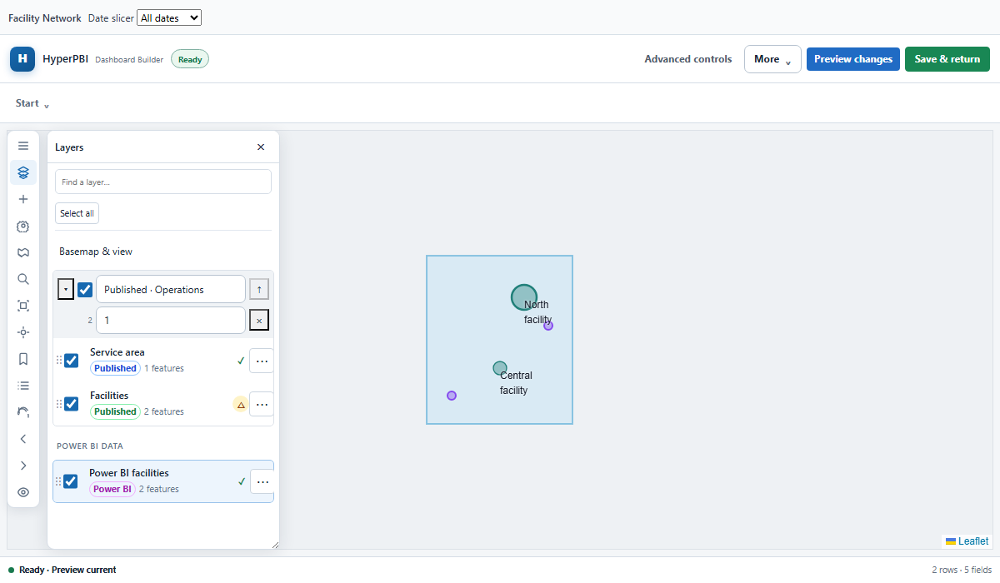
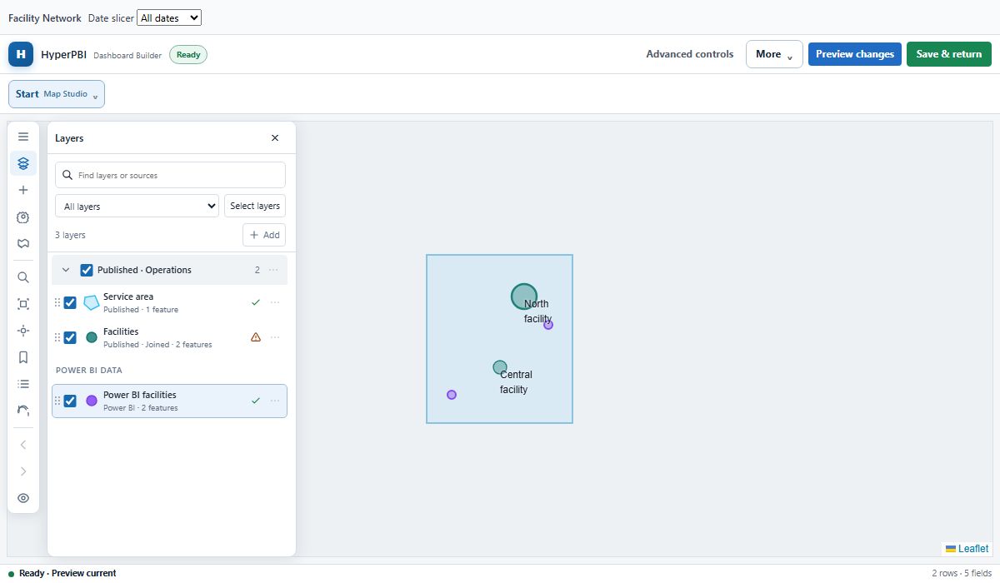
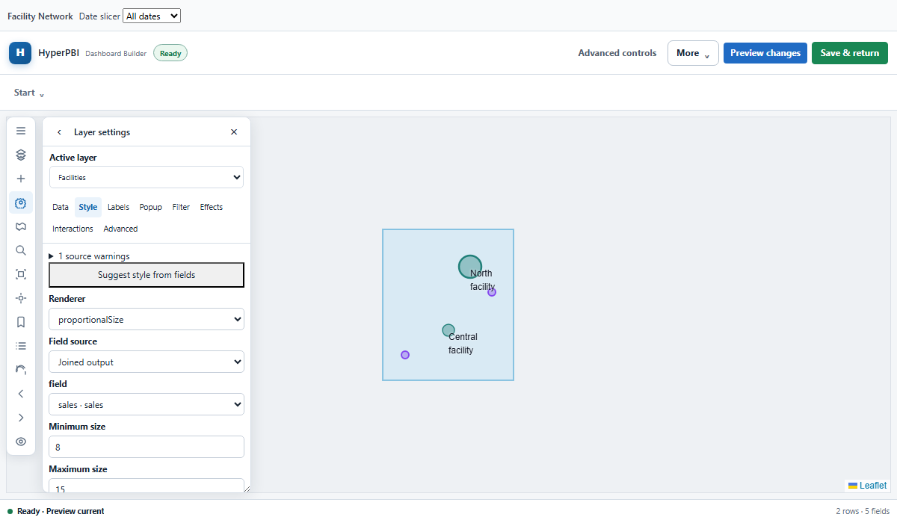
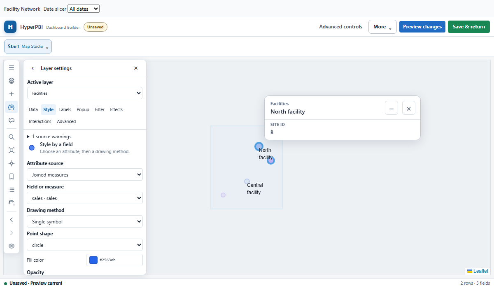

# Map Studio UI/UX delivery

Implemented against `main` at `6a7bc58` (2026-11-06). Leaflet, the canonical schema, Power BI identities, source adapters, caching, cancellation, feature limits, and the specification history remain in place.

## What changed

- **Contents:** compact symbol previews, accurate runtime feature counts and warnings, source filters, search through collapsed groups, modifier/range selection, explicit bulk selection, bulk visibility, and bulk group moves. Rename, duplicate, delete, group settings, keyboard ordering, cross-group drag/drop, and geometry-aware fit actions use the canonical edit pipeline. Tests exercise a 100-layer map.
- **Workspace:** one shared drawer width across panels, pointer and keyboard resizing, bounded menus/color pickers, rail separators and actual active-tool state, light/dark styling, and scrollable short-height layouts. Leaflet panes now stay behind editor controls. The workspace picker shares the header in narrow visuals.
- **Symbology:** field-first editing, readable method names, geometry-compatible choices, automatic categorical defaults, visual palettes, per-class colors, opacity, and numeric class boundaries. Palette changes preserve custom break labels, boundaries, and symbol settings. Manual breaks use the existing classification implementation.
- **Popups:** searchable fields, bounded Add Content menu, keyboard/drag ordering, chart-value removal, progressive disclosure of legacy templates/actions, and live preview of the actual selected feature. Preview actions are disabled; runtime actions and sanitization retain their existing contracts.
- **Sources:** explained source choices, connection help, and local GeoJSON file/paste import. New GeoJSON layers start with a valid empty collection instead of an invalid empty URL. Source organization/dataset settings are disclosed separately from the main connection fields. Existing join diagnostics and source-specific controls remain available.
- **Engineering:** Contents, symbology, source picking, GeoJSON import, drawer resizing, popup preview, symbol preview, and bounded popovers are focused components. The existing per-Studio command channel shares runtime references for preview; it creates no second map or source resolver. Windows line endings no longer produce false stale-documentation/example failures.

## Before and after

| Contents before | Contents after |
| --- | --- |
|  |  |

| Style before | Style after |
| --- | --- |
|  |  |

Additional reviewed captures: [default map](screenshots/after-default.png), [source picker](screenshots/after-source-picker.png), [classification editor](screenshots/after-classification.png), [labels](screenshots/after-labels.png), [popup builder](screenshots/after-popup-builder.png), [feature information](screenshots/after-feature-card.png), and [dark theme](screenshots/after-dark-theme.png).

Target viewport captures: [1200 × 700](screenshots/after-1200x700.png), [800 × 500](screenshots/after-800x500.png), [500 × 400](screenshots/after-500x400.png), and [350 × 300](screenshots/after-350x300.png). The harness includes a 42px report slicer above the application. Short drawers scroll; closing the drawer exposes the full map.

Reproduce screenshots with Vite running on port 4179:

```sh
node scripts/capture-map-studio.mjs .tmp/map-studio-review
```

## Main files

| Files | Purpose |
| --- | --- |
| `src/editor/map-studio/MapStudio.tsx`, `MapContentsPanel.tsx` | Canonical editing, Contents workflows, source configuration |
| `MapRendererEditor.tsx`, `MapLayerSymbol.tsx` | Field-driven symbology and previews |
| `PopupContentEditor.tsx`, `MapPopupPreview.tsx`, `MapFieldSelect.tsx` | Popup composition, actual-feature preview, searchable fields |
| `MapStudioPopover.tsx`, `MapColorPicker.tsx`, `MapDrawerResize.tsx` | Bounded overlays, focus, shared drawer sizing |
| `MapSourcePicker.tsx`, `MapGeoJsonInput.tsx` | Source choices and local GeoJSON import |
| `MapStudioRail.tsx`, `MapPropertyCategories.tsx` | Contextual navigation and capability explanations |
| `src/editor/HyperPbiStudio.tsx`, `src/editor/ui/StudioWorkspaceNav.tsx` | Compact workspace header/navigation |
| `src/components/maps/MapBlock.tsx`, `MapPopupContent.tsx` | Read-only runtime preview channel and inactive preview actions |
| `src/maps/interactions/mapStudioCommands.ts`, `src/maps/model/mapLayerOrigin.ts` | Runtime observations and source separation |
| `src/styles/hyperpbi-map-studio.css` | Responsive layout, themes, palettes and stacking |
| `tests/map-studio-contents.test.tsx`, `tests/map-studio-symbology.test.tsx`, `tests/browser/map-studio-workflows.spec.ts` | New workflow regressions |
| `tests/map-popup-content.test.tsx`, browser harness/baselines | Preview safety and visual verification |
| `scripts/capture-map-studio.mjs` | Repeatable screenshot capture |
| `scripts/generate-documentation.mjs`, `tests/dashboard-examples.test.ts` | Platform-neutral generated-file comparisons |
| `apps/web/public/runtime/`, `apps/playground/dist/` | Rebuilt checked-in distributions |

## Verification

- Full unit suite: **169 files / 830 tests passed**. Two additional symbology regressions subsequently passed; the final focused run passed **11 tests in 6 files**.
- Full Chromium suite: **53 tests passed**, including native selection, row lineage, cross-filtering, ArcGIS refresh/identify, joins, persistence, and retained map geometry. The final affected-suite rerun passed **13 tests**, including all four target viewports and bounded popup menus.
- Root and web typechecks, ESLint, documentation consistency, Next.js production build, and playground typecheck/build pass.
- Screenshots reviewed for stacking, clipping, swatch visibility, drawer reachability, and target viewport behavior. Classification palettes and short-height headers were corrected during visual review.

The Vite build retains its existing large-chunk warning; Power BI formatting utilities emit existing missing-sourcemap notices during unit tests.

## Limits and follow-up priorities

- The canonical schema supports **one group level**, so this implementation does not invent nested group storage.
- Categorical/manual preview controls use up to **200 loaded features** and **25 unique categories**. Automatic runtime classification uses the full resolved layer within existing feature budgets. External fields require source metadata/inspection when not already known.
- Geometry-specific choices become authoritative after geometry loads. Existing authored renderers remain preserved when data or capabilities change.
- Images and links require HTTPS; actions stay declarative. Arbitrary JavaScript and iframe popup content remain unavailable.
- The smallest visual uses an overlay and scrolling. Close the drawer when inspecting map features underneath it.
- Native Power BI Desktop/service host behavior should receive a release smoke test with real model identities and WebAccess policies; the automated browser host verifies the existing selection bridge contracts.
- Useful follow-ups: richer editable icon mappings, larger categorical legends, and deeper hierarchy only after an explicit canonical schema design.
